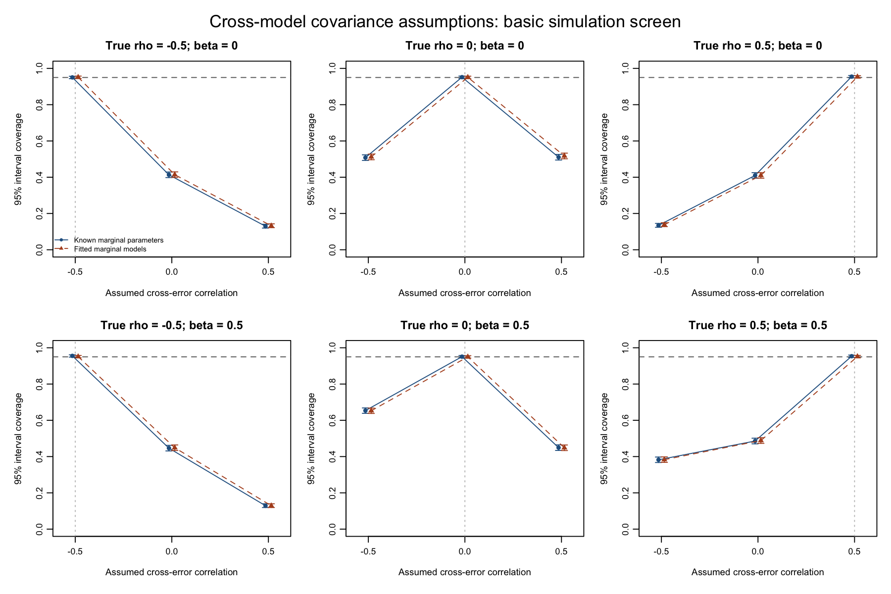

# Basic simulation screen for explicit cross-model covariance

November 4, 2026. Repeated-sampling validation accompanying PR #24. This screen
evaluates covariance propagation and scenario-specific inference; it does not
estimate cross-model covariance, choose an assumption from the results, or change
the REPAIR estimator. PRs #21/#22 and CRAN submission remain outside this work.

## Design and estimand

The full factorial has 48 conditions, with **500 independent replicates each**:

| Factor | Values |
|:--|:--|
| People N | 50, 200 |
| Nominal observations per person m | 6, 12 |
| Layout | Balanced; unbalanced counts repeating m/2, m, 3m/2 |
| True same-occasion observation-error correlation rho | -0.5, 0, 0.5 |
| True structural slope beta | 0, 0.5 |

Both processes use the same paired occasions, evenly spaced from -1 to 1 within
person. Unbalanced counts average approximately, rather than exactly, the nominal
m when N is not divisible by three. All errors are Gaussian, homoscedastic and iid
within each process; both observation-error SDs are 1.5. Cross-process observation
errors have correlation rho at the same occasion and zero covariance otherwise.

The target random slopes are `b_x ~ N(0,1)` and
`b_y = beta * b_x + eta`, with independent `eta ~ N(0,0.8^2)`.
Each process has a unit-variance random intercept correlated 0.2 with its own
slope. Fixed intercept/slope pairs are (2, 0.4) and (1, -0.2). The structural
regression uses the likelihood-only y slope as outcome and the x slope as its
single predictor, with a structural intercept. The estimand is beta on this
unstandardized scale.

Each dataset is analyzed with assumed correlations -0.5, 0, and 0.5, using both
minimum and default step-up regularization. The same observations are reused for
all assumptions, measurement-parameter modes and regularization policies:

* **Known:** observation-error variances and fixed slopes are known. Scores and
  their error covariance are derived independently by closed-form OLS, which is
  GLS for this iid design.
* **Fitted:** two separate Gaussian lmer random-intercept/random-slope models are
  fitted by REML with BOBYQA and `maxfun = 100000`. Fitted fixed slopes and marginal
  residual variances enter the likelihood-only scores and error blocks. The
  cross-error correlation is still supplied, never estimated.

For centered times, the extraction factor is `h_i = 1 / sum(time_i^2)`.
Prediction-error variances are `sigma_x^2 * h_i` and `sigma_y^2 * h_i`;
cross-covariance is `rho * sigma_x * sigma_y * h_i`. The simulation evaluates this
closed form efficiently and calls the unchanged public `fit_mmom()` for every
structural fit. In the first five replicates of **every condition**, it checks
the closed form against public `repair_data()` and `repair_cross_covariance()`,
and compares estimates, SEs, intervals and selected alphas with literal
`repair_sensitivity()` calls. All 1,440 public scenario fits and 2,880 R/C++
backend comparisons passed at tolerance 1e-9.

There are **24,000 simulated datasets**, 48,000 marginal MLM fits, and **288,000
structural fits**. No failed dataset or structural fit is discarded. Singular
marginal fits are retained and counted, matching the package's existing policy.
Uncertainty intervals use the package's conditional normal reference calculation.
An additional OLS analysis of the true latent slopes provides a measurement-free
normal-interval benchmark.

## Results

### Correct assumptions

| Measurement parameters | Overall coverage | Condition-level coverage range | Condition-level bias range |
|:--|--:|:--|:--|
| Known | 95.28% | 93.2%–97.0% | -0.0230 to 0.0247 |
| Fitted marginal models | 95.15% | 93.2%–97.2% | -0.0255 to 0.0279 |

Each condition has 500 replicates; the Monte Carlo SE for coverage near 95% is
about 0.97 percentage points. The overall values pool 24,000 replicates per
measurement mode and regularization policy, with MCSE approximately 0.14
percentage points. The regularization policies are paired duplicates here and
are **not** counted as additional independent replicates. Small finite-sample
bias remains: fitted-model bias pooled within each true-rho/beta combination
ranges from -0.00775 to 0.00752, with MCSE about 0.0028–0.0034.

For fitted models under correct assumptions, mean reported SE divided by empirical
SD ranges from 0.906 to 1.117 across conditions. Consequently, the pooled coverage
result is not a claim of exact SE calibration in every condition. The latent-slope
OLS benchmark's condition-level normal-interval coverage ranges from 92.0% to
96.8%, illustrating the Monte Carlo variability and finite-N reference setting.

The empirical prediction-error variances/covariances agree with their propagated
values: the largest absolute paired discrepancy divided by its Monte Carlo SE
is 2.554 across all 288 condition/mode/component comparisons. These are multiple
descriptive checks, not a collection of predeclared significance tests. Empirical
checks use within-replicate sample covariance of score-minus-true-slope errors;
sample centering removes common fixed-slope shifts. This verifies the average
within-person extraction-error covariance, not uncertainty in estimating rho.

### Misspecified assumptions

The following pooled null-effect results use fitted marginal models, minimum
regularization, and 4,000 replicates per row (eight N/m/layout conditions):

| True rho | Assumed rho | Bias | 95% interval coverage | Type I error |
|--:|--:|--:|--:|--:|
| -0.5 | -0.5 | 0.0067 | 95.15% | 4.85% |
| 0 | 0 | -0.0003 | 95.10% | 4.90% |
| 0.5 | 0.5 | -0.0077 | 95.38% | 4.63% |
| -0.5 | 0 | -0.3261 | 41.40% | 58.60% |
| 0.5 | 0 | 0.3310 | 41.00% | 59.00% |
| -0.5 | 0.5 | -0.6006 | 13.20% | 86.80% |
| 0.5 | -0.5 | 0.6084 | 13.80% | 86.20% |

Monte Carlo SE is about 0.34 percentage points for a 95% rate and 0.78 points
for a 41% rate in these pooled rows. Full tables also retain wrong nonzero
assumptions when true rho is zero, nonzero structural effects, RMSE, empirical
SD, mean/RMS SE, power, and all condition-level results. Positive and negative
misspecification results are not averaged into a cancelling bias estimate.



The figure pools the eight N/m/layout conditions per panel and assumption, shows
minimum regularization, and includes 95% Wilson intervals for Monte Carlo coverage
uncertainty. The dashed horizontal line is 95%; the vertical line marks the true
rho. Known and fitted modes are horizontally offset slightly for visibility.
A [vector PDF](results/coverage.pdf) is also available.

These are admissible covariance matrices even when statistically misspecified.
Passing the PSD checks does not establish that an assumption is correct.
Sensitivity analysis reveals dependence on assumptions; it does not identify rho,
guarantee coverage under an unknown rho, or justify choosing a preferred result.

### Failures and regularization

* Zero measurement-fitting failures, zero structural failures, and zero native
  fitting warnings in the screen. There were 78 datasets (0.325%) with at least
  one singular marginal fit; these were retained.
* Every step-up fit selected alpha 3 in both stages, with no fallback. All
  144,000 paired minimum/step-up estimates, SEs and interval endpoints were
  identical. This screen therefore supplies **no repeated-sampling evidence for
  activated adaptive selection or fallback inference**. Existing tests cover
  their numerical mechanics; harder designs require separate statistical study.

## Scope and interpretation

This supports the correctness and basic statistical behavior of explicit
covariance propagation in these two-process iid, paired-observation,
one-predictor Gaussian conditions. It also demonstrates why independence needs
substantive justification. It does not establish universal coverage, optimal
regularization, or performance for estimated cross-covariance parameters,
non-Gaussian errors, missing/unmatched occasions, serial/heterogeneous errors,
nested nuisance effects, additional structural predictors, or more than two
measurement models. Those implementation paths have algebraic/engineering tests
but are not repeated-sampling conditions in this screen. No covariance estimator
or statistical tuning change is introduced.

## Reproduction and result files

From the repository root, with the PR package installed:

```sh
OMP_NUM_THREADS=1 VECLIB_MAXIMUM_THREADS=1 OPENBLAS_NUM_THREADS=1 \
  Rscript dev/covariance-screen/simulate.R --reps=500 --workers=8 \
  --audit_reps=5 --output=check/covariance-screen
Rscript dev/covariance-screen/summarize.R check/covariance-screen
Rscript dev/covariance-screen/plot.R
```

Set `R_LIBS_USER` if using an isolated package library. The scripts require only
repair, its installed dependencies, and base/recommended R packages. The recorded
run used R 4.5.2, lme4 2.0.6, S7 0.2.2, Rcpp 1.1.2, and the PR #24 package
implementation at `7394c75949705f0505e4a1690e52e66b5db77e93`. Subsequent changes
to frozen-reference comparison tolerances do not alter that implementation.

The seed is 20261104, using L'Ecuyer-CMRG streams by condition and substreams by
replicate. Stream assignments are independent of worker scheduling and of how
many public-interface audits are requested. Replaying the first five replicates
of conditions 1 and 2 with two rather than eight workers gave identical saved
replicate statistics, diagnostics and audit results. No stochastic retries or
failed-attempt replacement are used.

Per-condition RDS checkpoints, the full replicate results, manifest, worker log,
and timing remain under the ignored `check/covariance-screen/` directory. They
can be recreated with the commands above. The run consumed 3,015 summed worker
seconds; timing is descriptive, not a benchmark. Committed results include:

* [Condition-level performance](results/performance.csv), including Monte Carlo
  SEs, Wilson uncertainty bounds, tails, failures, alphas and fallback rates.
* [Pooled performance](results/pooled-performance.csv), keeping true and assumed
  correlations separate.
* [Prediction covariance checks](results/prediction-covariance.csv).
* [Measurement-fit and latent-oracle diagnostics](results/measurement-and-oracle.csv).
* [Public-interface audits](results/interface-audits.csv),
  [failure/warning counts](results/failures-and-warnings.csv), and
  [design](results/design.csv).
* [Session information](results/session-info.txt),
  [run manifest](results/run-manifest.txt), and
  [checkpoint integrity hashes](results/checkpoint-md5.csv). The hashes identify
  this archived run; elapsed times and absolute output paths make whole-checkpoint
  hashes machine-specific even when replicate results reproduce.
