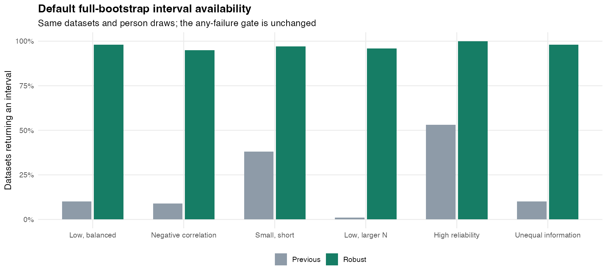
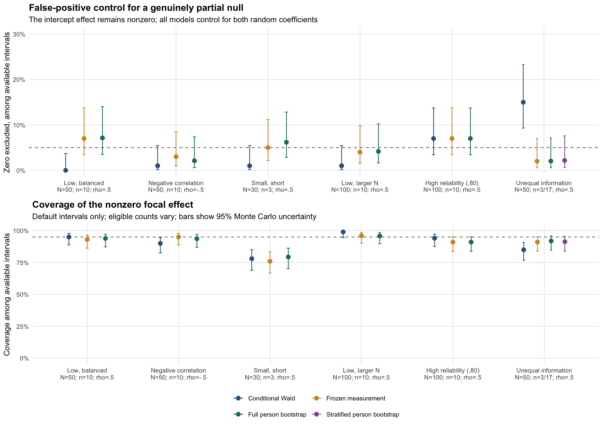

# Deterministic robust lmer refitting

## Trigger and diagnosis

The paper-inspired bootstrap screen (2026-10-30) used correlated random
intercept/slope predictors, six measurement profiles, 100 outer replications,
paired focal null/alternative outcomes and B=499. Of 348,302 distinct native
measurement resamples, 2,363 (0.678%) were rejected by the existing convergence
policy. Default interval availability was only 1–53% across profiles, because
one failed coefficient vector withholds inference. Singular-but-usable fits were
already retained. The failures were gradient/Hessian/identifiability warnings,
not structural moment failures or primarily exhausted evaluation budgets.

Development used the first 20 failures/profile, in fixed replication/mode/draw
order. Cold BOBYQA resolved 119/120 but sometimes gave worse likelihoods.
Explicit nloptwrap 1e-8 stopping tolerances with maxeval=200000 left all
120 unresolved. In installed lme4 2.0.6 those tolerances already equal the
defaults (maxeval defaults to 100000); only the budget increased. This did not
test tighter-than-default nloptwrap stopping tolerances. BOBYQA initialized at the nloptwrap
theta resolved 119/120 and matched/improved the original objective in all cases.
The remaining case had a near-unidentifiable Hessian. These are diagnostic
results on selected failures, not estimated full-grid recovery probabilities.

## Implementation and design workflow

1. Preserve the original package commit, simulation outputs, source hashes and
   failure histories; work on a separate `codex/robust-lmer-refits` branch.
2. Diagnose causes before changing the fitting or eligibility policy. Compare
   deterministic optimizer candidates on a fixed development subset.
3. Add opt-in `repair_lmer_refitter()` rather than changing the meaning of
   existing original fits. Require rebuilding the original measurement and
   REPAIR analysis with the new recipe.
4. Use nloptwrap for initialization, then tighter BOBYQA. Retry cold and from a
   deterministic interior perturbation only if necessary. Select a converged
   BOBYQA result only when its deviance is within 1e-6 of the best finite attempt.
   Keep unresolved fits rejected, including converged candidates that fail that
   objective check. Preserve model structure and ordinary convergence checks.
5. Persist the recipe in each fitted model and apply it automatically in native
   reference/replacement replay. Compare the declared policy as part of the
   configuration contract; callbacks cannot silently change it. Keep each
   attempt, selected index, objective, warnings/messages and singularity in the
   refit and bootstrap audit. An unresolved finite model remains inspectable with
   a warning; reference/replacement inference rejects it.
6. Test real recorded failures against an independent manual optimizer fit,
   deterministic recovery/retry branches, unresolved and inferior-fit rejection,
   weights/offsets/ML/contrasts/nested groups, RNG isolation, identity replay,
   bootstrap attempt records and saved-model replay. Retain existing tests.
7. Freeze the numerical recipe and rerun all original datasets/draws. Compare
   default availability and coverage with explicit denominators and matched
   datasets, retaining successes-only as a labeled diagnostic. Assess B1999 on
   the same preselected first-three/profile subset. No replacement resamples.

The complete study scripts/results are in the blup_unshrinking repository at
`vig_hallquist_2026/analysis/repair_bootstrap_pilot/robust_refit/`. This numerical
rerun reuses the screen's data and is not independent confirmatory evidence.

## Scope and residual limitations

The helper covers supported Gaussian lmer formulas. nlme and existing optimizer
recipes keep their previous behavior. Factors need supported coding and explicit
complete measurement rows; missing observations are not silently removed.
Improved numerical convergence does not establish percentile-interval validity,
resolve weak measurement/structural identification, or repair M-MOM point bias.
The default any-failure gate and explicit successes-only opt-in are unchanged.

The strategy follows the restart/tolerance/cross-optimizer recommendations in
[lme4's convergence guide](https://lme4.github.io/lme4/reference/convergence.html),
while retaining the package's stricter replay and likelihood checks.

## Completed paired simulation results

The rerun used the same six profiles, generated datasets, source streams and
person draw maps as the original screen. There were 600 measurement datasets,
1,200 paired structural analyses and B=499 attempted person resamples per analysis.
An unequal-information stratified comparator reused each profile's fixed 3/17
schedule counts. Structural errors were Gaussian/homoskedastic; both correlated
latent intercept and slope entered the structural regression, including a
nonzero intercept effect when the focal slope was null. This is standard
minimum-regularized M-MOM, not adaptively tuned M-MOMS or the full manuscript grid.

### Failure recovery and availability

The original failure breakdown was 1,538 gradient warnings, 822 Hessian/scaled-
gradient warnings, two near-identifiability warnings and one roundoff-limited
optimizer return. All original downstream failures were at measurement fitting.

The robust run had **27 unresolved measurement fits in 349,300 distinct requested
resamples (0.0077%)**, versus 2,363/348,302 (0.678%) originally. It recovered
**2,349/2,363 old failures (99.4%)**; 14 remained rejected and 13 formerly usable
draws were newly rejected. Of the 27 remaining rejections, 19 failed the likelihood
safeguard and eight had no converged BOBYQA candidate. Of the recovered old
failures, 1,039 selected robust fits were singular but passed the retained
convergence policy. Merely suppressing or recategorizing singularity was not the
fix: the old policy already retained usable singular fits.

There were 698,723 internal optimizer fits for the retained main resamples.
Only 90 requested resamples needed retries beyond the initial nloptwrap/BOBYQA
pair. These counts refer to distinct retained resamples, not paired outcomes,
reference replays, public-API validation calls or duplicate scheduling checks.
The robust recipe ordinarily performs two optimizer fits, so this availability
gain has a computational cost; the public bootstrap still repeats reference
validation for each attempt.

| Measurement profile | Default ordinary CI available, old → robust (/100) | Conditional coverage (.40), N=100 | Robust bootstrap coverage (.40), returned CI N |
|---|---:|---:|---:|
| Low reliability, balanced | 10 → 98 | 95% | 93.9% (92/98) |
| Negative intercept–slope correlation | 9 → 95 | 90% | 93.7% (89/95) |
| Small, short panels | 38 → 97 | 78% | 79.4% (77/97) |
| Larger sample, low reliability | 1 → 96 | 99% | 95.8% (92/96) |
| High reliability control | 53 → 100 | 94% | 91.0% (91/100) |
| Unequal information | 10 → 98 | 85% | 91.8% (90/98) |

Ordinary default intervals were delivered for **584/600 measurement datasets
versus 121/600**, with no previously available ordinary intervals lost. Null and
alternative interval-availability counts are the same. The additional unequal-
information stratified comparator improved from 15/100 to 92/100 available.
The default any-failed-draw rule and successes-only accessor opt-in are unchanged.

### Coverage, Type I error and interpretation

For unequal information, partial-null rejection changed from conditional 15/100
(15%) to robust bootstrap 2/98 (2.0%). On the common 98 eligible datasets, the
paired rejection change was −12.2 percentage points (95% Monte Carlo interval
−19.4 to −5.1). The paired nonzero-effect coverage change was +6.1 points
(−0.1 to +12.4), so the exact size of that coverage gain remains uncertain.

Coverage is not uniformly improved. Small/short panels remain severely
undercovered: mean standardized point bias is −.207 for a true effect of .40,
and successes-only bootstrap coverage is 77/100. Balanced-null rejection changes
from 0/100 to 7/98 (7.1%); increased nonnull detection is not a power comparison
at equal size. Full and frozen-measurement cases intervals remain close, so
this screen provides limited evidence for a separate incremental benefit from
measurement-parameter refitting over empirical person resampling.

The largest absolute standardized original point-estimate change was 0.0000772.
All original conditional coverage and rejection decisions were unchanged.
The numerical strategy principally restores the practical availability of
bootstrap inference, while exposing the estimator's existing statistical limits.
Rates above condition on a returned interval. The bundled matched comparisons
hold eligibility common; neither those nor successes-only summaries make failure
selection ignorable. With 100 eligible datasets, a 95%/5% rate has MC SE about
2.2 percentage points. This is a screening rerun on reused data, not independent
confirmatory evidence.

### B sensitivity

The preselected first three datasets/profile were extended to B=1999 without
selecting on results. All 18 measurement datasets now return ordinary default
intervals for both outcomes, and all three unequal-profile stratified datasets
do too; previously none did. None of the 42 paired ordinary/stratified coverage
decisions changed from B499 to B1999; the largest absolute endpoint shift was
.0738. This checks inner-tail stability on a small subset, not coverage precision.

## Executed validation and review artifacts

- Source-package check: no errors; examples, vignettes and **2,037 test assertions**
  pass with no test failures/warnings/skips. One local toolchain warning comes
  from R's external `Boolean.h` header about `-Wfixed-enum-extension`.
- All 600 main and 18 sensitivity checkpoints passed driver checks. Old/new
  generated data and person-draw maps agree exactly. Source, reference,
  installed-library and source-snapshot hashes remained fixed during the run.
- Cached original coefficients/SEs agree with public `repair()` to maximum
  absolute error 4.53e-14. Each eligible original passes public identity replay.
- **24 complete public bootstrap calls / 2,376 attempts** match draw maps,
  complete-vector decisions and coefficients (maximum scaled error 1.98e-14).
- **20 stratified public refits** agree (maximum scaled coefficient and absolute
  SE errors 1.28e-15). Public percentile intervals, SDs and failure gates match
  independent calculations. B499 prefixes match B1999, including coefficients,
  SEs, eligibility and frozen estimates. Raw-result rates were independently
  recalculated. Saved robust models replay in a fresh R process without the old
  callback closure.

The [compact review bundle](robust-refit-simulation/README.md) contains profile
parameters, method and dataset-level interval summaries, matched contrasts,
optimizer recovery, remaining failures, sensitivity results, figures, validation
and provenance. Run `Rscript dev/robust-refit-simulation/verify-results.R` (base R)
to independently check all 64 published method/profile/effect summaries from
retained endpoints. The bundle documents the full research archive location;
it does not claim to contain all raw measurement fits or full-run drivers.

The package usage guide and reference help distinguish numerical retries within
one requested person draw from replacement bootstrap attempts. Existing fitting
recipes and nlme behavior remain unchanged. This PR depends on the person-
bootstrap implementation in #14; its review base is `codex/person-bootstrap`.
Merge #14 first, then retarget this PR to `main` before merging.
